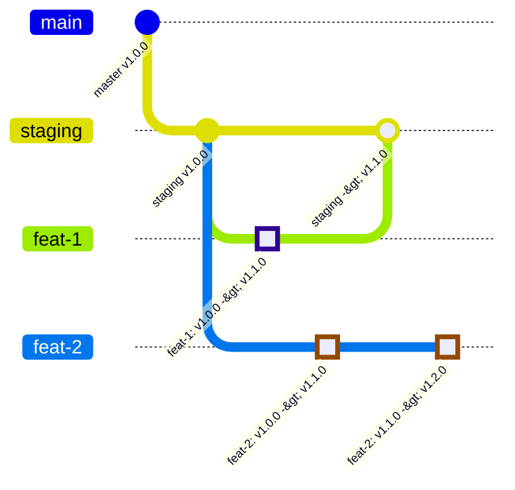

# auto-version-hook

A Git pre-commit hook written in Python: on every commit it determines the branch class
from the branch name, takes the base version from the branch this work is being promoted
to (`target`), and updates the version in a YAML file (`env.yml` by default). The modified
file is added to the index right away (`git add`) — the version lands in the commit itself.

Supports both trunk-based (feature → master) and GitFlow (feature → staging → master,
hotfix → master bypassing staging): the branch lifecycle is described by a declarative
`branch_flow` graph. Full specification: [docs/branch-flow-design.md](docs/branch-flow-design.md).

## How it works

1. Merge commits are skipped (`hooks.skip_merges`, true by default);
2. the branch name is matched against the `branch_flow` classes top-down (first match wins);
   a branch that matches nothing is an "invalid branch name" error and the commit is blocked;
3. the version base is read from `origin/<target>`: the target class resolves to a concrete
   branch as follows — first, a branch named **exactly like the class** (`origin/staging` for
   the `staging` class); otherwise the class regex is matched against origin branches, and
   there must be exactly one match (more than one is an error: name the class after the branch
   you need, or tighten the regex); none — walk up the `target` chain (no staging → base from
   main);
4. the class policy is applied:
   - `increment` — take the target version and increment the given `parse_regex` group
     (`v1.2.3` on a feature → `v1.3.3`); written only if higher than the local version
     (idempotent, no downgrades);
   - `keep` (protected) — no bump; if the branch version is below the target version it
     quietly catches up;
   - `ignore` — the target version is force-written (never bumped);
5. the modified file is `git add`-ed.

The default graph (works without any config): `main` (master/main) ← `staging`
(dev/development/staging) ← `feature`; `patch` → main bypassing staging; `tech` → staging
with the `ignore` policy. A trunk-based team simply doesn't need the `staging` class — if
there is no staging branch on origin, features automatically base on main.

### Hotfixes and quiet catch-up

The point of a hotfix is to get a fix to the release fast, bypassing pipeline bureaucracy:
clients, business and production matter more than green tests and double-checking. Such
merges are supervised by the team lead and/or the project manager, who understand the
consequences, so the `patch` class goes straight into `main`, while `staging` **quietly
catches up** on its next commit — the manual GitFlow practice of "pulling the hotfix into
develop" becomes automated. Catch-up can't do any harm: the version only ever goes up, and
only when staging is genuinely behind.

## Installation

From GitHub, straight into the current environment:

```sh
pip install git+https://github.com/AndrewZakh/auto-version-hook.git
```

Or from a local checkout:

```sh
python3 -m venv .venv && . .venv/bin/activate
pip install .          # provides the auto-version-hook command
./scripts/install.sh   # installs .git/hooks/pre-commit into the current repository
```

`scripts/install.sh` takes the repository path as an argument and backs up an existing hook.

Manual option — the `.git/hooks/pre-commit` file:

```sh
#!/bin/sh
exec auto-version-hook "$@"
```

[pre-commit framework](https://pre-commit.com) option (local hook, no environment isolation):

```yaml
repos:
  - repo: local
    hooks:
      - id: auto-version
        name: auto version bump
        language: system
        entry: auto-version-hook
        always_run: true
        pass_filenames: false
```

## Configuration

The config is a YAML file (`version-hook.yml` or `.version-hook.yml` at the repository root;
the path can also be set via `--config` or the `AUTO_VERSION_HOOK_CONFIG` environment
variable). A full example with the default values — [config.example.yml](config.example.yml):

```yaml
version:
  file: env.yml        # version file, relative to the repository root
  key: version         # path to the version inside the file (yq syntax)
  parse_regex: '^v(?P<major>\d+)\.(?P<minor>\d+)\.(?P<patch>\d+)$'   # named groups

git:
  remote: origin
  fetch: true          # ls-remote + fetch of the targets on every run

branch_flow:           # order = matching priority, first match wins
  - {name: main,    regex: '^(master|main)$', protected: true, policy: keep}
  - {name: staging, regex: '^(dev(elop(ment)?)?|stag(ing)?)$', protected: true,
      target: main, policy: keep}             # no bump; behind main — quiet catch-up
  - {name: patch,   regex: '^patch', target: main, policy: increment, bump: patch}
  - {name: feature, regex: '^feat(ure)?', target: staging, policy: increment, bump: minor}
  - {name: tech,    regex: '^devops/tech.+', target: staging, policy: ignore}

hooks:
  auto_stage: true     # git add the version file after changing it
  on_error: fail       # fail — block the commit, warn — let it through with a warning
  skip_merges: true    # don't fire on merge commits
```

Class fields: `name`, `regex` (re.search against the branch name), `protected`, `target`
(the name of another class — where we promote to and where the base comes from), `policy`
(`increment`/`keep`/`ignore`), `bump` (a group from `parse_regex`, required for
`increment`), `reset_lower_parts` (zero out the numeric groups to the right of the bumped
one: `v1.2.3` → `v2.0.0`; non-numeric groups such as `mark` are preserved — `v1.2.3-rc1` →
`v1.2.4-rc1`).

The config is validated on every run: unique names, compilable regexes, existing targets,
no cycles, valid field combinations, bump groups present in `parse_regex`; overlapping
class regexes produce a warning. A legacy v1 config (`protected_branch`, the `bump`
section) is rejected with a migration hint.

To eyeball your branch lifecycle graph:

```sh
auto-version-hook --graph   # prints a Mermaid flowchart
```

Any option can be overridden on the command line: `--version-file`, `--version-key`,
`--parse-regex`, `--remote`, `--no-fetch` (offline: no ls-remote/fetch, existing
remote-tracking refs only), `--no-stage`, `--on-error {fail,warn}`; plus utility flags:
`--config`, `--repo`, `--branch` (branch name override), `--dry-run`, `-v`, `-q`.
Exit codes: `0` — OK; `1` — error, the commit is blocked (not with `on_error: warn`);
`2` — argument/config problems.

## Example

```sh
$ git checkout -b feature/login
$ echo done >> app.py && git add app.py
$ git commit -m "login form"
auto-version-hook: feature/login [feature -> origin/staging]: v1.2.3 -> v1.3.3 in env.yml
$ git show HEAD:env.yml
version: v1.3.3
```

To see what would happen without touching any files: `auto-version-hook --dry-run --branch feature/login`.

## CI validator (`--check`)

A local hook is easy to bypass (`git commit --no-verify`), and server-side merges (the
Merge PR button) don't run pre-commit hooks at all. That's why the same tool also works as
a server-side validator: `auto-version-hook --check` prints nothing, it only checks —
exit code `0` "the version is correct", `1` "the hook would rewrite the file / the branch
is unknown or undefined", `2` "config problems". `on_error: warn` is ignored in this mode —
the validator is always strict.

CI runners check out in detached HEAD, so the branch is passed explicitly via `--branch`.
Ready-made examples: [ci/gitlab-ci.example.yml](ci/gitlab-ci.example.yml) (a `version-check`
job that handles MR pipelines via `CI_MERGE_REQUEST_SOURCE_BRANCH_NAME`) and
[ci/github-actions-version-check.example.yml](ci/github-actions-version-check.example.yml)
(a workflow for PRs and pushes to protected branches) — copy them into the target
repository and point them at your hosted copy of the package. A push to staging is
validated too: if staging has fallen behind main (a hotfix landed), the pipeline keeps
failing until the catch-up is done — per our "the fast don't wait for the slow" philosophy,
the conflict is resolved before the protected branch.

## Behavior the team should know about

### Live base

A feature's base is not "the version at branch creation time" but the **current** version
of the target branch (staging) at the moment of the commit. Step by step:

1. staging is at `v1.0.0`. `feat-1` and `feat-2` branch off it.
2. The author of `feat-1` commits: the base is staging `v1.0.0`, the feature gets `v1.1.0`.
3. The author of `feat-2` commits: staging is still at `v1.0.0`, so the feature also gets
   `v1.1.0` (two features with the same number is fine — see "Version coalescing" below).
4. `feat-1` is merged into staging → staging becomes `v1.1.0`.
5. The author of `feat-2` makes the next commit: the base is now `v1.1.0` → the version
   recomputes to `v1.2.0`. Their PR will raise staging to `v1.2.0` (and with equal versions
   the merge goes through without a conflict — both branches made the identical one-line edit).



Why: the fast don't wait for the slow; conflicts in `env.yml` and breakage from other
people's changes surface before the protected branch; you can see your colleagues working.
The hook doesn't fire on merge commits (`skip_merges`) or during rebase — that's why in
step 5 the recomputation happens on a **regular** commit: pull staging into the feature
(a merge — the hook is skipped), and the next commit already gets the new version.

Other nuances:

- **Version coalescing.** In the example above `feat-1` and `feat-2` both carried `v1.1.0`
  and land under the same minor — deliberately: one minor version = a batch of features.
  If an `env.yml` conflict does occur (both branches managed to recompute from different
  bases), the rule is simple: **take the larger one**.
- **Server-side merges (the Merge PR button) don't run pre-commit hooks** — the version
  arrives in the protected branch exactly as it was committed on the feature; the pipeline
  additionally verifies it with `--check` (see "CI validator").
- **`git commit --no-verify`** bypasses the hook locally — but not CI: `--check` keeps
  failing until the version is up to date.

## Development

```sh
pip install -e ".[dev]"
pytest
```

The tests create throwaway git repositories in a temporary directory and run the hook
end to end (trunk-based and GitFlow scenarios, including feat-1/feat-2, catch-up and
merge-skip).

## License

Licensed under the [MIT license](LICENSE).
