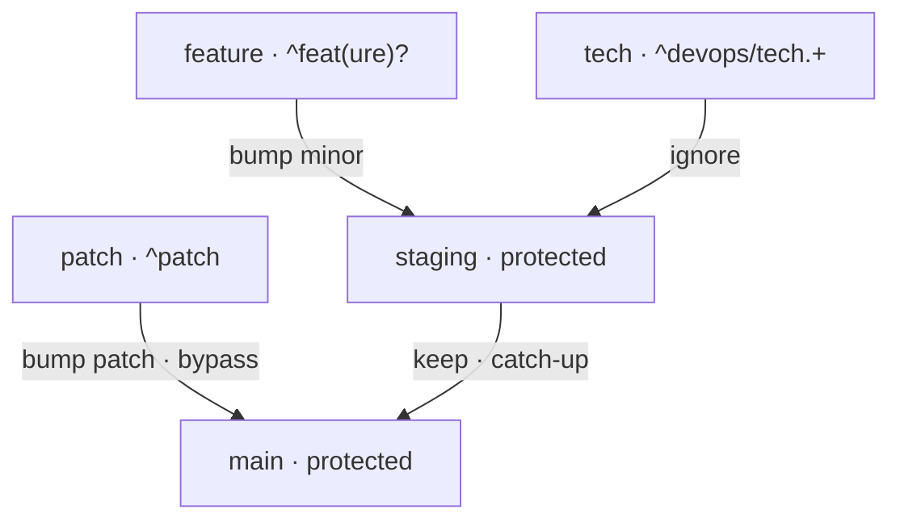

# branch_flow — v2 specification (agreed design, pre-implementation)

Goal: support both trunk-based (feature → main) and GitFlow (feature → staging → main,
hotfix → main bypassing staging) with a declarative promotion graph instead of a single
`protected_branch`. Discussed and agreed on 2026-10-24.

## Config

```yaml
version:
  file: env.yml
  key: version                       # yq-style path to the version inside the file
  parse_regex: '^v(?P<major>\d+)\.(?P<minor>\d+)\.(?P<patch>\d+)$'

git:
  remote: origin
  fetch: true                        # fetch the target branches on every run

branch_flow:                         # order = matching priority when the branch name matches
  - name: main                       # release branch
    regex: '^(master|main)$'
    protected: true
    policy: keep                     # a direct commit doesn't bump the version

  - name: staging                    # intermediate (integration)
    regex: '^(dev(elop(ment)?)?|stag(ing)?)$'
    protected: true
    target: main
    policy: keep                     # no bump; if behind main's version — quiet catch-up

  - name: patch                      # hotfix: bypassing staging, straight to main
    regex: '^patch'
    target: main
    policy: increment
    bump: patch                      # name of a parse_regex group
    reset_lower_parts: false

  - name: feature
    regex: '^feat(ure)?'
    target: staging
    policy: increment
    bump: minor
    reset_lower_parts: false

  - name: tech
    regex: '^devops/tech.+'
    target: staging
    policy: ignore                   # the version is force-synced with the target

hooks:
  auto_stage: true
  on_error: fail
  skip_merges: true                  # don't fire on merge commits (MERGE_HEAD present)
```

Trunk-based — the same without the `staging` class (feature.target: main).

**Removed:** `git.protected_branch`, the entire `bump` section (`rules`,
`ignore_branches_regex`, `protected_action`, the global `reset_lower_parts`), the
`--protected-branch` CLI option.
**Added to the CLI:** `--graph`.

## Class fields

| field | required | description |
|---|---|---|
| `name` | yes | identifier; `target`s refer to it |
| `regex` | yes | matches the local branch name (re.search — anchor it yourself) |
| `protected` | no (false) | a direct commit doesn't bump the version |
| `target` | for non-protected | the class the base version is taken from |
| `policy` | yes | `increment` \| `keep` \| `ignore` |
| `bump` | for `increment` | the `parse_regex` group to increment |
| `reset_lower_parts` | no (false) | zero out the numeric groups to the right of the bumped one |

Combination rules (checked by the validator): `protected` ⇒ `policy: keep` and no `bump`;
non-protected ⇒ `policy ∈ {increment, ignore}` and `target` set; `increment` ⇒ `bump`
set and present in `parse_regex`.

## Run semantics (pre-commit)

1. If a merge is in progress (`MERGE_HEAD` exists) and `hooks.skip_merges` — exit right
   away, do nothing.
2. The branch is matched against the classes top-down, first wins. No match → "invalid
   branch name" error, the commit is blocked (the `on_error: warn` valve remains).
   Detached HEAD → do nothing.
3. The target class resolves to a concrete remote branch (`git ls-remote --heads`) in three
   steps, for each class of the chain from nearest to farthest: (1) a branch named **exactly
   like the class** exists (`origin/<name>`) — take it; (2) otherwise the class regex:
   exactly one match — take it, several — an error listing the candidates (hint: name the
   class after the branch you need — an exact name always wins); (3) none — walk up the
   `target` chain to the first existing one (staging not created yet → base from main).
4. `keep` (protected): the file is not bumped; if the target exists and the local version is
   **below** the target's — write the target version (auto catch-up). main (no target) —
   just leave it alone.
5. `increment`: new = bump(target version, the `bump` group, `reset_lower_parts`).
   Write new only if it is **higher** than the local version; local ≥ new → leave it alone
   (idempotency + no downgrades).
6. `ignore`: write the target version as is (the old per-branch ignore semantics).
7. The modified file is `git add`-ed (`hooks.auto_stage`).

Version comparison: the numeric `parse_regex` groups left to right (major → minor → patch);
non-numeric groups (`mark`) don't participate in the comparison.

## Live base (the feat-1 / feat-2 scenario)

feat-1 and feat-2 branched off staging v1.0.0 → both get v1.1.0 (the identical one-line
edit — the merge into staging goes through without a conflict). feat-1 is merged:
staging v1.1.0.

- The author of feat-2 pulled staging in (a merge — the hook is skipped by `skip_merges`)
  and made another commit → the live base is v1.1.0 → feat-2 becomes v1.2.0; its PR will
  raise staging to v1.2.0.
- The author of feat-2 hasn't committed since → their PR carries v1.1.0 == staging's
  version → feat-2's changes land under the current version (coalescing into one minor).
  A deliberate consequence, see below.

The rationale for the live base: the fast don't wait for the slow; conflicts and breakage
are caught before the protected branch; colleagues' work is visible. Rebase doesn't run
hooks (git behavior) — the version recomputes on the next regular commit.

## Deliberate consequences (accepted)

- **Version coalescing.** The staging version grows from the features' "claimed" versions,
  not from the number of merges: several features off the same base get the same number
  and land under one minor (or produce an env.yml conflict on merge — resolution: take the
  larger value).
- **Server-side merges (the PR button) don't run hooks.** The version changes only through
  commits; the source-of-truth file arrives in the protected branch exactly as committed.
- **Non-numeric groups (mark) don't participate in the comparison:** v1.2.3-rc1 and
  v1.2.3-rc2 are considered equal.
- **A local `git merge --squash` is a regular commit** (no MERGE_HEAD is created), and the
  hook fires on it.

## Implementation notes

- With `git.fetch: false`, don't hit ls-remote: resolve the target classes from the
  existing remote-tracking refs (`refs/remotes/<remote>/*`).
- Log what was chosen: the branch class, the target class, the concrete target branch, the
  base version.
- An old config (v1: `protected_branch`, the `bump` section) must produce a clear error
  referring to this spec, not a context-free "unknown section".
- Incrementing a number does not preserve leading zeros: `007` → `8` (not `008`).
- `ls-remote` → a single `git fetch` for all the needed target branches (one refspec each).

## Config validation (on every load)

- class names are unique; all regexes compile;
- a class name that doesn't look like a valid branch name — a warning (exact `origin/<name>`
  resolution is impossible for such a class);
- `target` refers to an existing class; the graph is a DAG, cycles are forbidden;
- the field combinations from the table above; `bump` groups exist in `parse_regex`;
- overlapping regexes of different classes → a warning (matching is order-based);
- the previous checks: `parse_regex`, `version.key` (yq path), `on_error`, etc.

## `--graph`

`auto-version-hook --graph [--config ...]` — validates the config and prints a Mermaid
flowchart of the branch lifecycle graph:



A full-blown Gitflow chart (lanes) was deemed excessive; a flowchart with policy labels
is enough.

## `--check` (CI validator, added after spec v2)

`--check` is the server-side validation mode (covers `--no-verify` and the server-side
merges that pre-commit doesn't run): like `--dry-run` (writes nothing, the `would_change`
flag in HookResult), but with exit codes 0 — correct, 1 — the hook would rewrite the file,
the branch is unknown or undefined (detached HEAD / a merge under skip_merges; in CI pass
`--branch` from the runner variables), 2 — config/environment problems. `hooks.on_error:
warn` is ignored — the validator is always strict. Example jobs — `ci/gitlab-ci.example.yml`,
`ci/github-actions-version-check.example.yml`; a push to staging validates the catch-up.
